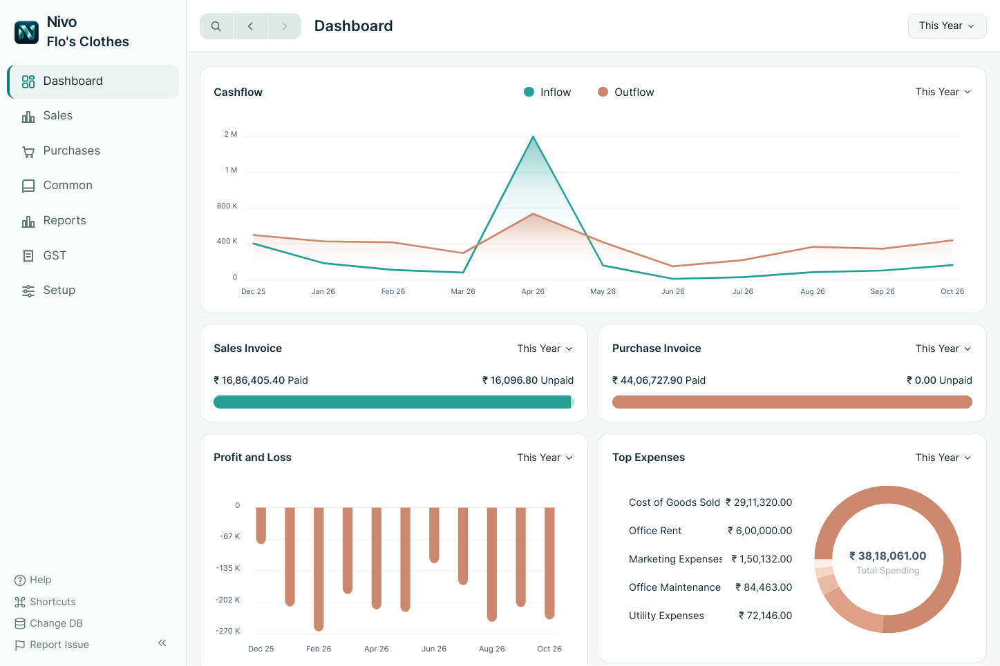

<div align="center">

  <br />
  
  <br /><br />

  # Nivo

  <p><strong>The modern, offline-first desktop accounting suite crafted for velocity, elegance, and sovereign data privacy.</strong></p>
  <p><em>Built on Electron & Vue 3 • Powered by Embedded SQLite • Zero Cloud Dependencies</em></p>

  <br />

  <p>
    <a href="https://github.com/sifat-939/nivo/releases/latest"></a>
    &nbsp;
    
    &nbsp;
    <a href="LICENSE"></a>
    &nbsp;
    
  </p>

  <p>
    <a href="#-downloads"><strong>Get Nivo</strong></a> &nbsp;•&nbsp;
    <a href="#-the-nivo-philosophy"><strong>Philosophy</strong></a> &nbsp;•&nbsp;
    <a href="#-core-modules"><strong>Features</strong></a> &nbsp;•&nbsp;
    <a href="#-bengali-user-guide"><strong>Documentation</strong></a> &nbsp;•&nbsp;
    <a href="#-engineering--architecture"><strong>Architecture</strong></a> &nbsp;•&nbsp;
    <a href="#-license--attribution"><strong>License</strong></a>
  </p>

  <br />

  <!-- Adaptive Light/Dark Mode Hero Showcase -->
  <picture>
    <source media="(prefers-color-scheme: dark)" srcset="docs/assets/nivo-dashboard-dark.png">
    <source media="(prefers-color-scheme: light)" srcset="docs/assets/nivo-dashboard.png">
    
  </picture>

  <p><sub><em>Interactive Financial Dashboard featuring real-time cash flow monitoring, invoice tracking, and expense analytics.</em></sub></p>

</div>

---

## ⚡ The Nivo Philosophy

Most business accounting software today is slow, bloated with unused features, and locked behind recurring monthly subscriptions and invasive telemetry.

**Nivo takes an uncompromising stance:**

<table width="100%">
  <tr>
    <td width="33.3%" valign="top">
      <h3>🔒 Sovereign Data</h3>
      <p>Your financial ledger belongs to you alone. All invoices, vouchers, and transactions live strictly on your machine in an isolated, portable SQLite file (<code>.db</code>). No cloud servers, no third-party telemetry, no vendor lock-in.</p>
    </td>
    <td width="33.3%" valign="top">
      <h3>⚡ Instant Velocity</h3>
      <p>Experience zero-latency desktop responsiveness. With instant page switches, minimal RAM overhead, and seamless keyboard navigation, Nivo is crafted for rapid everyday bookkeeping.</p>
    </td>
    <td width="33.3%" valign="top">
      <h3>🛡️ Autonomous Continuity</h3>
      <p>Zero mandatory accounts, zero internet requirements, and no subscriptions. Automatically maintains timestamped daily backups on your device so your business never misses a beat.</p>
    </td>
  </tr>
</table>

---

## 📥 Downloads

Ready-to-run release packages for 64-bit systems are available on the [**GitHub Releases Portal**](https://github.com/sifat-939/nivo/releases/latest).

| Platform / Edition | Target OS | Description | Download |
|:---|:---:|:---|:---:|
| **Windows Setup** | Windows 10 / 11 (64-bit) | Standard installer with Desktop icon and Start Menu shortcuts | [**`Nivo-Setup.exe`**](https://github.com/sifat-939/nivo/releases/download/v0.40.5/Nivo-v0.40.5-windows-x64-setup.exe) |
| **Windows Portable** | Windows 10 / 11 (64-bit) | Zero-install portable executable; ideal for USB sticks or isolated workflows | [**`Nivo-Portable.exe`**](https://github.com/sifat-939/nivo/releases/download/v0.40.5/Nivo-v0.40.5-windows-x64-portable.exe) |
| **Linux AppImage** | Modern 64-bit Linux | Self-contained executable for Ubuntu, Debian, Fedora, Arch, and more | [**`Nivo.AppImage`**](https://github.com/sifat-939/nivo/releases/download/v0.40.5/Nivo-v0.40.5-linux-x86_64.AppImage) |
| **Integrity Check** | All Platforms | Cryptographic SHA-256 hashes to verify download authenticity | [**`SHA256SUMS.txt`**](https://github.com/sifat-939/nivo/releases/download/v0.40.5/SHA256SUMS.txt) |

> 💡 **Windows SmartScreen Tip:**  
> Because Nivo is an open-source, community-distributed build without an enterprise code-signing certificate, Windows SmartScreen may show an *"Unknown Publisher"* warning. Click **"More info"** and then **"Run anyway"** on initial launch.

### Linux Quick Start
```bash
chmod +x Nivo-v0.40.5-linux-x86_64.AppImage
APPIMAGE_EXTRACT_AND_RUN=1 ./Nivo-v0.40.5-linux-x86_64.AppImage
```

---

## 📖 Bengali User Guide & Visual Walkthrough

For business owners, accountants, and operators in Bangladesh, we maintain an extensive, illustrated reference manual:

<div align="center">
  <table width="100%">
    <tr>
      <td align="center" style="padding: 20px;">
        <h3>📘 Nivo Bangla Practical User Guide (PDF)</h3>
        <p><strong>58 comprehensive pages • 52 real-world operational workflows • Complete synthetic screenshot walkthroughs</strong></p>
        <p>Covers opening balances, sales/purchase voucher creation, payment allocations, salary processing, inventory reconciliation, daily accounting checklists, and automated backup management.</p>
        <br />
        <a href="output/pdf/Nivo-Bangla-Guide.pdf"><strong>Download Bengali User Guide (PDF) →</strong></a>
      </td>
    </tr>
  </table>
</div>

---

## ✨ Core Modules

<table width="100%">
  <tr>
    <td width="50%" valign="top">
      <h3>🧾 Invoicing & Receivables</h3>
      <ul>
        <li><b>Sales & Purchase Invoices:</b> Multi-item billing with discounts, payment tracking, and optional inventory ledger posting.</li>
        <li><b>Payment Allocations:</b> Accurate party ledger settlements, partial payment support, and advance allocations.</li>
        <li><b>Customer & Supplier Ledgers:</b> Complete transaction histories, balances, and print-ready statement generation.</li>
      </ul>
    </td>
    <td width="50%" valign="top">
      <h3>📊 Financial Intelligence</h3>
      <ul>
        <li><b>Double-Entry General Ledger:</b> Strict debit/credit balance integrity for every posted transaction.</li>
        <li><b>Bank & Cash Management:</b> Real-time cash registers, bank account reconciliation, and fluid liquidity tracking.</li>
        <li><b>Standard Financial Statements:</b> Instant Profit & Loss reports, Balance Sheets, Trial Balances, and Cash Flow charts.</li>
      </ul>
    </td>
  </tr>
  <tr>
    <td width="50%" valign="top">
      <h3>👥 HR & Payroll Engine</h3>
      <ul>
        <li><b>Employee Directory:</b> Staff records, designations, department classifications, and compensation profiles.</li>
        <li><b>Salary Processing:</b> Monthly salary disbursements with unique period-locking to eliminate duplicate payments.</li>
        <li><b>Salary Vouchers:</b> Audit-compliant expense vouchers and salary distribution slips.</li>
      </ul>
    </td>
    <td width="50%" valign="top">
      <h3>⚙️ Customization & Control</h3>
      <ul>
        <li><b>Modular Toggles:</b> Adapt the application to your workflow by enabling/disabling modules via <code>Settings → Features</code>.</li>
        <li><b>Print Layout Designer:</b> Clean standard templates with custom logos, branding headers, signatures, and payment terms.</li>
        <li><b>Adaptive UI:</b> Refined dark and light themes crafted for focus and eye comfort during demanding sessions.</li>
      </ul>
    </td>
  </tr>
</table>

---

## 🛠️ Engineering & Architecture

Nivo is engineered using a robust, clean desktop stack:

```
┌────────────────────────────────────────────────────────┐
│                      Nivo Desktop                      │
│             (Electron Multi-Process Bridge)            │
├──────────────────────────┬─────────────────────────────┤
│      Frontend Layer      │        Backend Layer        │
│   • Vue 3 Composition    │   • Node.js Main Process    │
│   • Tailwind CSS Design  │   • Native IPC Action Demux │
│   • Reactive Stores      │   • Document State Engine   │
├──────────────────────────┴─────────────────────────────┤
│                   Storage & Core Data                  │
│              • Native SQLite3 Engine                   │
│              • Strict Double-Entry Schema              │
│              • Automated Snapshot Backups              │
└────────────────────────────────────────────────────────┘
```

- **Runtime:** [Electron](https://www.electronjs.org/)
- **UI Framework:** [Vue.js 3](https://vuejs.org/) with [Tailwind CSS](https://tailwindcss.com/)
- **Programming Language:** [TypeScript](https://www.typescriptlang.org/)
- **Database Engine:** Embedded [SQLite](https://www.sqlite.org/) via native bindings
- **Testing Suites:** Automated UI regression with Playwright and Tape

---

## 💻 Local Development

### Prerequisites
- **Node.js:** `^22.0.0`
- **Yarn:** Classic `1.22.22`

```bash
# Clone the repository
git clone https://github.com/sifat-939/nivo.git
cd nivo

# Enable Yarn and install frozen dependencies
corepack enable
yarn install --frozen-lockfile --ignore-scripts
node node_modules/electron/install.js
node node_modules/esbuild/install.js
yarn postinstall

# Start Nivo in local development mode
yarn dev
```

### Verification & Testing
```bash
# Verify TypeScript typing
yarn typecheck

# Run test suite
yarn test:nivo

# Run security and repository privacy checks
python3 scripts/check-repository.py
```

### Packaging & Builds
- **Windows:** `yarn build:windows`
- **Linux:** `yarn build --linux AppImage --x64 --nosign --publish never`

---

## 🔐 Data Privacy Architecture

Nivo strictly separates application binaries from user company data:
- **Linux Storage:** `~/.local/share/nivo/data/`
- **Windows Storage:** `%APPDATA%\nivo\data\`

All databases, logs, secrets, and private credentials are excluded from version control via `.gitignore`. Rebuilding the application or pushing changes never touches, transmits, or exposes your proprietary accounting records. See [Installation & Storage Specs](docs/installation.md) for details.

---

## 📜 License & Attribution

Nivo is open-source software licensed under the **GNU Affero General Public License v3.0** ([AGPL-3.0-only](LICENSE)).

- **Upstream Project:** Derived from [Frappe Books](https://github.com/frappe/books) created by [Frappe Technologies Pvt. Ltd.](https://frappe.io).
- All upstream copyrights, trademarks, and the original [Upstream README](docs/upstream-readme.md) are fully acknowledged and preserved.
- Code audits, test coverage, and migration histories are documented in the [Final Audit Report](docs/final-audit-2026-10-29.md).
