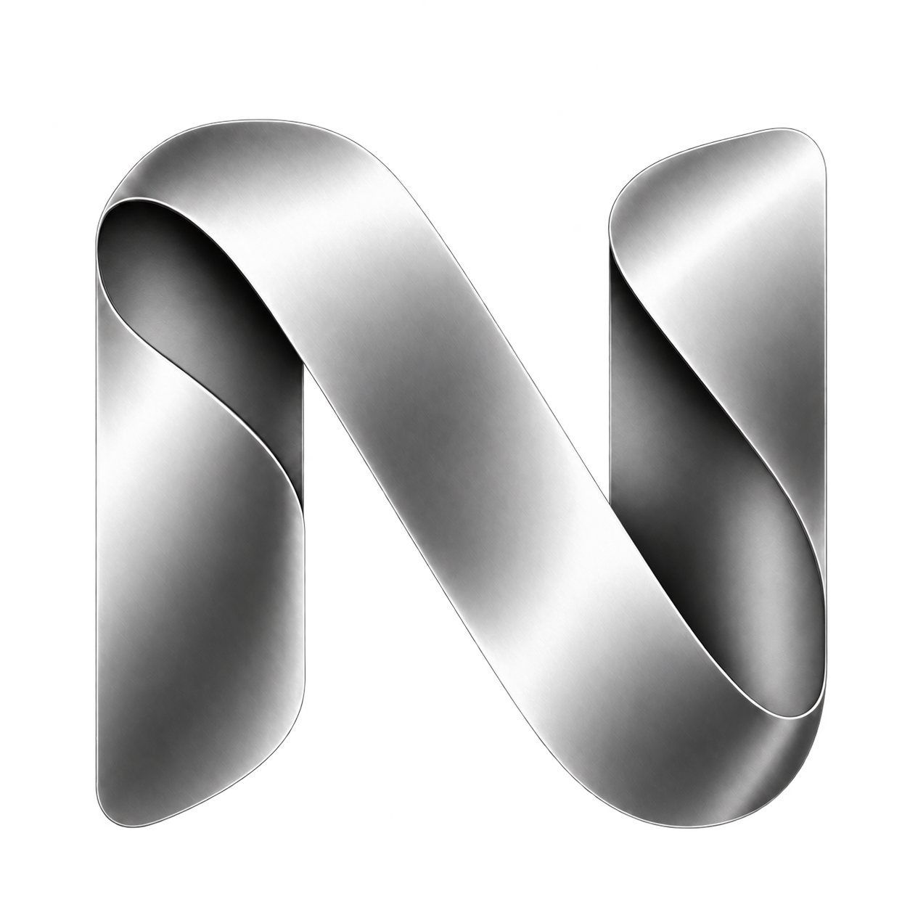

# Nivo



An offline desktop accounting application designed for small businesses. Built on the Electron/Vue edition of Frappe Books, featuring a distinct Nivo brand identity, a clean minimal interface, and light/dark theme support.

## Download & Installation (Windows & Linux)

Visit the repository's [Releases](https://github.com/sifat-939/nivo/releases) page to download the latest version.

### Windows (10 / 11, 64-bit)
- `Nivo-v<version>-windows-x64-setup.exe` — Standard installer (recommended for most users). Installs the app with desktop and Start menu shortcuts.
- `Nivo-v<version>-windows-x64-portable.exe` — Portable version that runs directly without installation. Company data is stored securely in your user profile, not inside the executable.
- `SHA256SUMS.txt` — Checksums to verify file integrity.

*Note: Since the installer is self-published and not yet signed with an expensive EV certificate, Windows SmartScreen may show an unknown publisher warning. Click "More info" and then "Run anyway" on first launch.*

### Linux
- `Nivo-v<version>-linux-x86_64.AppImage` — Standalone AppImage for 64-bit Linux distributions. Make the file executable (`chmod +x`) and run.

## User Guide & Documentation

- [Complete Bengali User Guide (PDF)](output/pdf/Nivo-Bangla-Guide.pdf) — 58-page comprehensive guide covering 52 practical accounting workflows, real screenshots, daily checklists, and backup procedures.

## Key Features

- **Billing & Invoicing:** Sales Invoices, Purchase Invoices, Payment Entries, Parties (Customers & Suppliers), Items, and General Ledger reports.
- **Financial Accounts:** Expense tracking, Bank & Cash accounts, and Cash Flow visibility.
- **HR & Payroll:** Employee records and Salary Payment processing with duplicate-period prevention.
- **Customizable Modules:** Easily toggle optional business features from Settings → Features.
- **Modern User Experience:** Minimal transparent Nivo branding, curved UI components, and adaptive Light/Dark mode.
- **Offline & Private Data:** Local SQLite databases with automated daily backups. No cloud dependency or third-party tracking.

**Printing:** One Nivo Standard A4 design covers invoices and customer/supplier statements. Configure your logo, signature and payment QR in Settings → Print. See [Print Guide](docs/standard-print.md).

## Working with an AI assistant

Start with [AGENTS.md](AGENTS.md) and the [AI onboarding guide](docs/ai/README.md). They cover architecture, safe data boundaries, setup/tests, change recipes and current product decisions. Claude Code, Copilot and Gemini entry points reuse these instructions; Cursor can read AGENTS.md directly. A generic bootstrap prompt is included for other assistants.

## Development

Requires Node.js **22** and Yarn Classic **1.22.22**.

```bash
corepack enable
yarn install --frozen-lockfile --ignore-scripts
node node_modules/electron/install.js
node node_modules/esbuild/install.js
yarn postinstall
yarn dev
```

Run tests and verification:
```bash
yarn typecheck
yarn test:nivo
python3 scripts/check-repository.py
```

Build commands:
- Windows build (on Windows or GitHub Actions runner):
  ```bash
  yarn build:windows
  ```
- Linux AppImage:
  ```bash
  yarn build --linux AppImage --x64 --nosign --publish never
  ```

## Release Pipeline

To publish new releases, ensure the version is updated in `package.json`, then push a git tag:

```bash
git tag v0.40.4
git push origin v0.40.4
```

The GitHub Actions workflow runs automated test suites, regression checks, and publishes the Windows setup, portable executables, and Linux AppImage under GitHub Releases. See [Release Process](docs/release-process.md) for details.

## Project Structure & Privacy

| Directory | Purpose |
|---|---|
| `src/` | Vue frontend interface, pages, themes, and icons |
| `models/`, `schemas/`, `fyo/` | Accounting logic, document schemas, and calculation rules |
| `backend/`, `main/` | SQLite database operations, Electron main process, IPC handlers |
| `reports/`, `templates/` | Financial reports, print views, and standard templates |
| `tests/`, `uitest/` | Unit, regression, and packaged UI end-to-end tests |
| `build/`, `.github/workflows/` | Platform icons, CI/CD, and release packaging workflows |
| `scripts/` | Verification suites, Linux installer, and source auditing scripts |
| `docs/` | Architectural guides, migration history, and setup documentation |

**Privacy Notice:** Company databases, private credentials, `.env`, installers, and build caches are strictly excluded from git tracking.
- Linux company data: `~/.local/share/nivo/data/`
- Windows company data: `%APPDATA%\frappe-books\data\`

Downloading builds or uploading source code never transfers or exposes your local company databases. See [Installation & Data Storage](docs/installation.md).

## Compatibility & Limitations

Retains internal `frappe-books` identifiers solely to ensure backward database compatibility with existing user profiles. Upstream automatic updates are disabled. See [Migration Status](docs/karbar-import-run-2026-10-28.md).

## License & Upstream Attribution

Based on Frappe Books by Frappe Technologies Pvt. Ltd. Licensed under **AGPL-3.0-only** ([LICENSE](LICENSE)). All upstream copyrights and [Upstream README](docs/upstream-readme.md) are preserved.

See [Final Audit Report](docs/final-audit-2026-10-29.md) for code health and audit logs.
